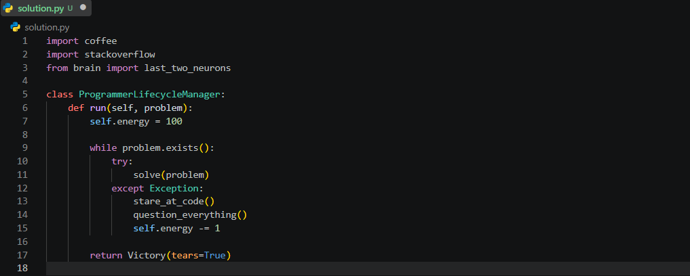

<div align="center">

# Programming Problem Solving

<p align="center">
    
</p>

[](#license)
[](#how-to-contribute)
[](https://github.com/Huerte/algo-solutions-python/issues?q=is%3Aissue+is%3Aopen+label%3A%22good+first+issue%22)

[](https://leetcode.com)
[](https://www.codewars.com)
[](https://www.hackerrank.com)
[](https://py.checkio.org/)
[](https://www.geeksforgeeks.org)

**A collection of algorithm solutions. Mostly Python, with every language welcome.**

**Open for everyone: beginners, experienced developers, students, and people who don't code.**

</div>

## About

This started as my personal collection of Python solutions to problems from LeetCode, Codewars, HackerRank, CheckiO, and GeeksforGeeks.

I'm growing it into a place where the **same problem is solved in many languages**, so learners can compare styles side by side. Most solutions are in Python for now, and I'd love your help adding more languages.

## Contributors

Built by people like you. Every avatar below started with a first pull request.

<!-- CONTRIBUTORS:START -->
<p align="center">
<a href="https://github.com/Huerte" title="Huerte"></a><a href="https://github.com/Kaliyugalaxmi" title="Kaliyugalaxmi"></a><a href="https://github.com/Aaqibhafeezkhan" title="Aaqibhafeezkhan"></a><a href="https://github.com/Vamsi-2581" title="Vamsi-2581"></a><a href="https://github.com/NarendraPati1" title="NarendraPati1"></a><a href="https://github.com/painpratham-ai" title="painpratham-ai"></a><a href="https://github.com/codekongdev" title="codekongdev"></a><a href="https://github.com/yinbowen-dc" title="yinbowen-dc"></a><a href="https://github.com/benrapps" title="benrapps"></a><a href="https://github.com/Golden007-prog" title="Golden007-prog"></a><a href="https://github.com/Kaveeshamalindi" title="Kaveeshamalindi"></a><a href="https://github.com/Doomguy-BFG9000" title="Doomguy-BFG9000"></a><a href="https://github.com/8Ashwinee" title="8Ashwinee"></a><a href="https://github.com/itsabhaysinghh" title="itsabhaysinghh"></a><a href="https://github.com/laishettikarthik-tech" title="laishettikarthik-tech"></a><a href="https://github.com/MatheoPaiva" title="MatheoPaiva"></a><a href="https://github.com/tylrcc" title="tylrcc"></a><a href="https://github.com/YTLim-1206" title="YTLim-1206"></a><a href="https://github.com/CoDe-ReDz" title="CoDe-ReDz"></a><a href="https://github.com/gd-pnjj" title="gd-pnjj"></a><a href="https://github.com/morrosusso" title="morrosusso"></a><a href="https://github.com/mxrfp" title="mxrfp"></a>
</p>
<!-- CONTRIBUTORS:END -->

**Want to see your face here?** Pick a [`good first issue`](https://github.com/Huerte/algo-solutions-python/issues?q=is%3Aissue+is%3Aopen+label%3A%22good+first+issue%22) and open a PR. No code needed for [`no-code-needed`](https://github.com/Huerte/algo-solutions-python/issues?q=is%3Aissue+is%3Aopen+label%3Ano-code-needed) issues.

## How to contribute

This repo is **open for everyone**. Any language, any level, no experience required. You can contribute without writing code at all.

**New to open source? Start here before anything else:**

**[First Contributions - github.com/firstcontributions/first-contributions](https://github.com/firstcontributions/first-contributions)**

Prefer video? Watch this: [How to contribute on GitHub (YouTube)](https://youtu.be/WldXhauP024?si=9u5wErqvnz9ZZRAv)

### Quick steps

1. Pick an [open issue](https://github.com/Huerte/algo-solutions-python/issues) and comment on it to claim it
2. Fork this repo
3. Clone your fork and create a new branch
4. Make your change
5. Commit, push, and open a Pull Request

### Ways to help

| I want to... | Look for the label or resource |
|---|---|
| Make my first contribution | [`good first issue`](https://github.com/Huerte/algo-solutions-python/issues?q=is%3Aissue+is%3Aopen+label%3A%22good+first+issue%22) |
| Help without writing code | [`no-code-needed`](https://github.com/Huerte/algo-solutions-python/issues?q=is%3Aissue+is%3Aopen+label%3Ano-code-needed) |
| Add a solution in any language | [`any-language`](https://github.com/Huerte/algo-solutions-python/issues?q=is%3Aissue+is%3Aopen+label%3Aany-language) |
| Improve docs or explanations | [`documentation`](https://github.com/Huerte/algo-solutions-python/issues?q=is%3Aissue+is%3Aopen+label%3Adocumentation) |
| Spend only 5 minutes | [`5-minutes`](https://github.com/Huerte/algo-solutions-python/issues?q=is%3Aissue+is%3Aopen+label%3A5-minutes) |
| Be mentored through my first PR | [`first-timers-only`](https://github.com/Huerte/algo-solutions-python/issues?q=is%3Aissue+is%3Aopen+label%3Afirst-timers-only) |
| Help document existing Python solutions | [Solutions Needing Attention](https://github.com/Huerte/algo-solutions-python/blob/main/TOPICS.md#solutions-needing-attention-9) |

### Adding a solution

- Add your file as `solutions/<language>/practice<next number>.<ext>`, for example `solutions/python/practice42.py` or `solutions/javascript/practice1.js`
- Use a lowercase language folder name (`python`, `javascript`, `typescript`, `java`, `cpp`, `c`, `csharp`, `go`, `rust`, `kotlin`, `swift`, `php`, `ruby`)
- The next number is the highest `practice<n>` in that folder plus 1
- Add a header comment with the problem name, link, and a one-line note
- Messy but working code is welcome, and I'll help polish it in review

Don't see a folder for your language? Create it. You'll be the first contributor for it, and I'll credit you here.

## Structure

Solutions are organized by language. Each file is named `practice<n>` in the order it was solved within that language's folder.

```
algo-solutions-python/
├── solutions/
│   ├── python/
│   │   ├── practice1.py
│   │   ├── practice2.py
│   │   └── ...
│   └── <your language>/        # any language is welcome
│       └── practice1.js
├── assets/
├── README.md
├── TOPICS.md
└── LICENSE
```

For problems classified by topic, see [TOPICS.md](TOPICS.md).

Each file includes the problem source and a short note at the top as a comment:

```python
# Problem: Two Sum
# Source: https://leetcode.com/problems/two-sum
# Note: Used a dictionary for O(n) lookup
```

## Platforms

| Platform | Best For | Beginner Problem |
| :--- | :--- | :--- |
| [LeetCode](https://leetcode.com/) | Technical interview preparation, algorithm patterns, and topic-tagged problem sets. | [Two Sum](https://leetcode.com/problems/two-sum/) |
| [Codewars](https://www.codewars.com/) | Gamified practice (kata) and discovering idiomatic solutions from the community. | [Multiply](https://www.codewars.com/kata/50654ddff44f800200000004) |
| [HackerRank](https://www.hackerrank.com/) | Structured skill tracks (algorithms, data structures, SQL) and company screening assessments. | [Solve Me First](https://www.hackerrank.com/challenges/solve-me-first/problem) |
| [CheckiO](https://checkio.org/) | Game-driven coding adventures with interactive Python and TypeScript mission islands. | [Multiply (Intro)](https://py.checkio.org/mission/multiply-intro/) |
| [GeeksforGeeks](https://www.geeksforgeeks.org/) | Comprehensive DSA concepts, company interview archives, and school-level problem ladders. | [Missing Number in Array](https://www.geeksforgeeks.org/problems/missing-number-in-array1416/1) |

## License

Distributed under the MIT License. See `LICENSE` for details.

---

&copy; 2026 Huerte
