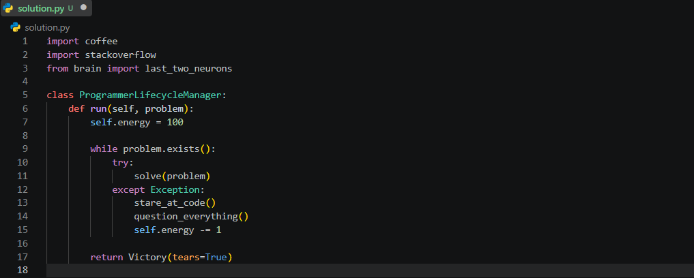

<div align="center">

# Programming Problem Solving

<p align="center">
    
</p>

[](#license)
[](#how-to-contribute)
[](../../issues?q=is%3Aissue+is%3Aopen+label%3A%22good+first+issue%22)

[](https://leetcode.com)
[](https://www.codewars.com)
[](https://www.hackerrank.com)
[](https://py.checkio.org/)
[](https://www.geeksforgeeks.org)

**A collection of algorithm solutions. Mostly Python, with every language welcome.**

**Open for everyone: beginners, experienced developers, students, and people who don't code.**

</div>

## About

This started as my personal collection of Python solutions to problems from LeetCode, Codewars, HackerRank, CheckiO, and GeeksforGeeks.

I'm growing it into a place where the **same problem is solved in many languages**, so learners can compare styles side by side. Most solutions are in Python for now, and I'd love your help adding more languages.

## Structure

Solutions are organized by language. Each file is named `practice<n>` in the order it was solved within that language's folder.

```
algo-solutions-python/
├── solutions/
│   ├── python/
│   │   ├── practice1.py
│   │   ├── practice2.py
│   │   └── ...
│   └── <your language>/        # any language is welcome
│       └── practice1.js
├── assets/
├── README.md
├── TOPICS.md
└── LICENSE
```

For problems classified by topic, see [TOPICS.md](TOPICS.md).

Each file includes the problem source and a short note at the top as a comment:

```python
# Problem: Two Sum
# Source: https://leetcode.com/problems/two-sum
# Note: Used a dictionary for O(n) lookup
```

## How to contribute

This repo is **open for everyone**. Any language, any level, no experience required. You can contribute without writing code at all.

**New to open source? Start here before anything else:**

**[First Contributions - github.com/firstcontributions/first-contributions](https://github.com/firstcontributions/first-contributions)**

Prefer video? Watch this: [How to contribute on GitHub (YouTube)](https://youtu.be/WldXhauP024?si=9u5wErqvnz9ZZRAv)

### Quick steps

1. Pick an [open issue](../../issues) and comment on it to claim it
2. Fork this repo
3. Clone your fork and create a new branch
4. Make your change
5. Commit, push, and open a Pull Request

### Ways to help

| I want to... | Look for the label |
|---|---|
| Make my first contribution | [`good first issue`](../../issues?q=is%3Aissue+is%3Aopen+label%3A%22good+first+issue%22) |
| Help without writing code | [`no-code-needed`](../../issues?q=is%3Aissue+is%3Aopen+label%3Ano-code-needed) |
| Add a solution in any language | [`any-language`](../../issues?q=is%3Aissue+is%3Aopen+label%3Aany-language) |
| Improve docs or explanations | [`documentation`](../../issues?q=is%3Aissue+is%3Aopen+label%3Adocumentation) |
| Help with design | [`design`](../../issues?q=is%3Aissue+is%3Aopen+label%3Adesign) |
| Translate the README | [`translation`](../../issues?q=is%3Aissue+is%3Aopen+label%3Atranslation) |
| Spend only 5 minutes | [`5-minutes`](../../issues?q=is%3Aissue+is%3Aopen+label%3A5-minutes) |
| Be mentored through my first PR | [`first-timers-only`](../../issues?q=is%3Aissue+is%3Aopen+label%3Afirst-timers-only) |

### Adding a solution

- Add your file as `solutions/<language>/practice<next number>.<ext>`, for example `solutions/python/practice42.py` or `solutions/javascript/practice1.js`
- Use a lowercase language folder name (`python`, `javascript`, `typescript`, `java`, `cpp`, `c`, `csharp`, `go`, `rust`, `kotlin`, `swift`, `php`, `ruby`)
- The next number is the highest `practice<n>` in that folder plus 1
- Add a header comment with the problem name, link, and a one-line note
- Messy but working code is welcome, and I'll help polish it in review

Don't see a folder for your language? Create it. You'll be the first contributor for it, and I'll credit you here.

## Contributors

Thanks to everyone who helps this collection grow.

<p align="center">
  <a href="../../graphs/contributors">
    
  </a>
</p>

## Platforms

## License

Distributed under the MIT License. See `LICENSE` for details.

---

&copy; 2026 Huerte
